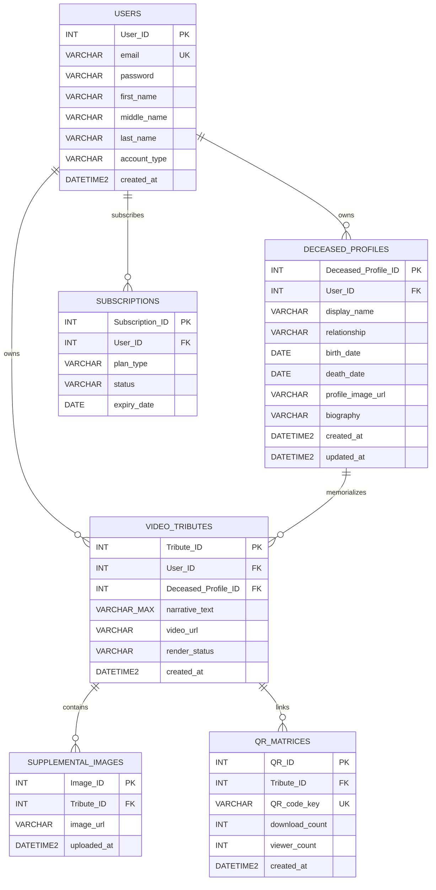

# Memento - Current SQL Server Data Model

This file documents the implemented Microsoft SQL Server model in `memento_database.sql`.

## Purpose of the multi-profile update

A Memento **family account** may preserve more than one deceased loved one. The login therefore owns multiple `DECEASED_PROFILES`, and the user selects one profile after authentication before viewing that person's tributes and QR codes.

## Relationships

| Parent | Child | Cardinality | Foreign key | Delete behavior |
|---|---|---:|---|---|
| `USERS` | `DECEASED_PROFILES` | 1:N | `DECEASED_PROFILES.User_ID` | CASCADE |
| `USERS` | `SUBSCRIPTIONS` | 1:N | `SUBSCRIPTIONS.User_ID` | CASCADE |
| `USERS` | `VIDEO_TRIBUTES` | 1:N | `VIDEO_TRIBUTES.User_ID` | CASCADE |
| `DECEASED_PROFILES` | `VIDEO_TRIBUTES` | 1:N | `VIDEO_TRIBUTES.Deceased_Profile_ID` | RESTRICT / NO ACTION |
| `VIDEO_TRIBUTES` | `SUPPLEMENTAL_IMAGES` | 1:N | `SUPPLEMENTAL_IMAGES.Tribute_ID` | CASCADE |
| `VIDEO_TRIBUTES` | `QR_MATRICES` | 1:N | `QR_MATRICES.Tribute_ID` | CASCADE |

A deceased profile cannot be deleted while it still owns tributes. The API returns a conflict message instead of deleting memorial content accidentally.

## Mermaid ERD

## Manuscript synchronization note

The uploaded manuscript currently shows five entities and connects `USERS` directly to `VIDEO_TRIBUTES`. Because the requested application flow now supports multiple deceased loved ones per family login, the manuscript ERD/data dictionary/storyboard should be updated to include `DECEASED_PROFILES` and the post-login profile-selection state if exact implementation/documentation parity is required.
